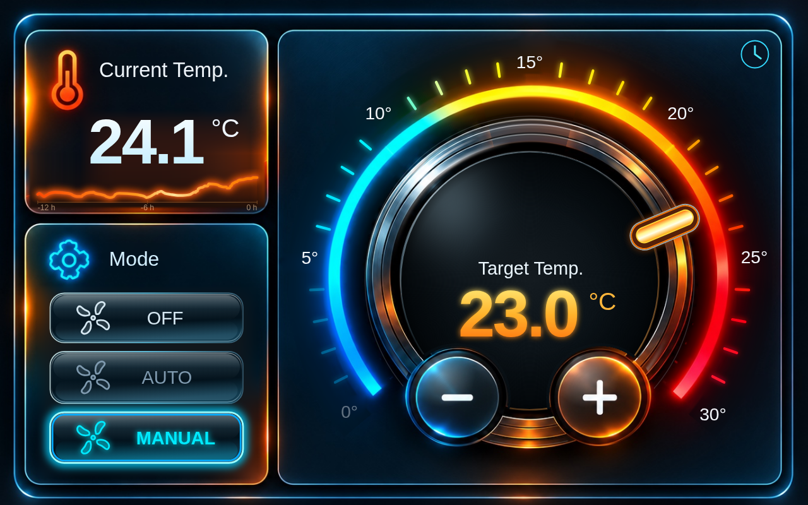

# Franky's Climate UI — v0.2.0



A standalone **visual-only** Lovelace climate interface by Franky's Stuff, based on the familiar JARVIS design. This is **not** an update to Frankys_Stuff Climate Card. Its heating behavior and source remain unchanged.


## Updated JARVIS UI

This is an **update to the existing card**, not a second card or design. The Home Assistant card type remains `custom:frankys-climate-ui-card` and the existing HACS installation and configurations remain valid. The new look replaces the previous interface automatically.

- Photo-realistic glass/neon thermostat with responsive mobile layout.
- Temperature dial scale adapts to the entity's configured min/max limits (including sauna, pool and Fahrenheit ranges).
- Recorder-backed glowing orange **12-hour** actual-temperature history; unavailable states create gaps and the graph restores on refresh.
- The existing mode actions, entity/helpers, flame options and schedule handling are retained. The visual configuration editor uses the existing fields; **no design selector** is needed.

### Existing configuration remains valid

```yaml
type: custom:frankys-climate-ui-card
display_entity: climate.living_room
control_entity: climate.living_room
language: auto
temperature_unit: auto
```

No migration, new resource, or additional HACS repository is required. A normal update will change the appearance for all existing cards.

## Functions

- Touch temperature ring with orange setpoint pointer and current-temperature marker.
- Plus and minus buttons; reads/writes Home Assistant target temperature.
- 12-hour recorder-backed temperature history, restored after browser reload.
- Left AUS / AUTO / MANUELL buttons: native climate modes if available, optional helper or explicit HA service/script actions otherwise.
- Orange heating flame: **on** when measured heating is active, **off** otherwise. No standby state.
- Optional direct flame toggle only for a deliberately selected, suitable heater actuator. No automatic detection of a mains supply plug; when AUS is selected the flame control is locked.
- Clock opens an **existing Home Assistant Schedule helper's native detail/editor dialog**. It appears only when a schedule is configured or linked to the climate entity.
- Visual card editor with **language** selection: Auto (Home Assistant), Deutsch, English. Number formatting follows the selected language (21,5 / 21.5).
- **Temperature units**: Auto (Home Assistant), Celsius (°C) or Fahrenheit (°F). Readings, setpoint, ring tick labels and schedule info use the chosen unit, while service calls retain their actual source entity units.
- Proportional SVG scaling without clipping the HUD's rounded corners when resized.
- **v0.1.2:** Home Assistant Sections cards now request 12 columns and automatic intrinsic height, preventing squeezed/overlapping dashboard rows. Explicit dashboard `grid_options.rows` values still override this default.

## Configuration

Minimal (works for native climate features; unsupported modes are disabled):

```yaml
type: custom:frankys-climate-ui-card
name: Wohnzimmer
display_entity: climate.wohnzimmer
language: auto
temperature_unit: auto
```

With existing HA helpers and heating status:

```yaml
type: custom:frankys-climate-ui-card
name: Schlafzimmer
display_entity: climate.schlafzimmer
language: de
temperature_unit: celsius  # or fahrenheit / auto
temperature_entity: sensor.schlafzimmer_temperatur
target_entity: input_number.schlafzimmer_soll
mode_entity: input_select.schlafzimmer_modus
heating_status_entity: binary_sensor.schlafzimmer_heizt
schedule_entity: schedule.schlafzimmer_heizplan
# flame_switch_entity: switch.separater_heizaktor
```

These entity IDs are **examples**, not automatically installed entities.

## How control works

| Surface | Home Assistant backend |
| --- | --- |
| Ring, +/- | `climate.set_temperature`, or `input_number.set_value` / `number.set_value` if `target_entity` configured |
| MANUELL | Native `heat`; otherwise `mode_entity` or custom action |
| AUTO | Native `auto`; otherwise `mode_entity` or custom action |
| AUS | Native `off`; otherwise `mode_entity` or custom action |
| Heating flame | `heating_status_entity` binary on/off, else native `hvac_action: heating` |
| Tap flame | Optional `flame_switch_entity` (`switch` or `input_boolean`) on/off; blocked when AUS |
| Clock | Native HA schedule entity's more-info UI (display/open only) |

**A climate entity exposing only `heat` and `off` does not have a real automatic time program.** The AUTO button will not fake one. To use a custom schedule, configure an existing HA helper and automation. This card never creates a helper, builds an automation, writes a schedule or overrides thermostat safety limits.

You may assign `mode_off_action`, `mode_auto_action` or `mode_manual_action` to a script entity ID (`script.example`) or a single Home Assistant service action in JSON. Such actions override the default mode button commands; the displayed selected mode must still be reported by the device or `mode_entity`.

### Installation

Add `https://github.com/Franz1302/frankys-climate-ui` to **HACS → Custom repositories** as category **Dashboard/Lovelace**, then install **Franky's Climate UI**. Add a new dashboard card with type `custom:frankys-climate-ui-card`. This repository is independent of Frankys_Stuff Climate Card; you can keep both cards installed.

### Testing

Core behavior simulated with native HVAC, helper modes, target temperature helper, heating sensor, on/off flame actor and AUS guard; JavaScript compilation and HUD markup render checked. Hardware testing and native schedule dialog verification remain outstanding. v0.1.2 is a preview; review behavior before controlling real heating hardware.

### License

MIT (see LICENSE).
